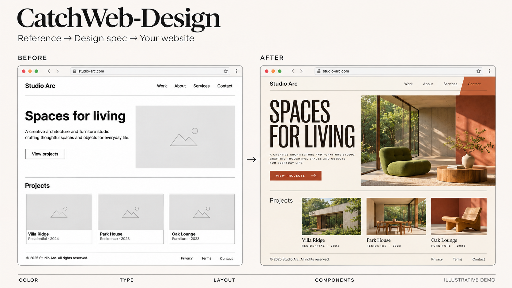

# CatchWeb-Design

**A website you like → a design spec you can build with.**

Turn a reference webpage into a detailed, browsable design specification and a reusable `DESIGN.md`. Give the result to your coding agent to bring that visual language into your own website: color, typography, spacing, layout, components, and motion.

[English](#what-it-does) · [中文](#中文介绍) · [MIT License](LICENSE)



*AI-generated illustrative concept. This explains the intended workflow; it is not an actual extraction benchmark or a verified before/after result.*

## What it does

- **Extract the design language.** Understand visual character, hierarchy, density, composition, and the relationship between sections.
- **Make the details usable.** Record color roles and HEX values, font families and type scales, spacing, grids, padding, corners, borders, and shadow parameters.
- **Keep what makes a website distinctive.** Select components with meaningful variants or clear interaction differences instead of filling a generic checklist.
- **Show the specification.** Deliver a browsable page with swatches, real text specimens, dimension diagrams, corner previews, and component states.
- **Support style transfer.** Export `DESIGN.md` for an agent to restyle another website while preserving its content and product behavior.
- **Keep evidence and files together.** Separate measured values, observations, estimates, and unknowns. Save each study in one portable folder.

The rules are framework agnostic. They can guide the restyling of an existing website or the visual development of a new one. Implementation happens in your target project with your coding agent.

## Install

Clone this repository into your agent's skills directory. For a local Codex installation:

```bash
git clone https://github.com/damonjobs2-dev/CatchWeb-Design.git ~/.codex/skills/catchweb-design
```

Preserve existing local changes before updating a skill with the same name. Open a new agent session if it has not appeared yet. For another skill-capable agent, use its supported skills directory or ask it to read [`SKILL.md`](SKILL.md).

Requirements: browser, screenshot, and local file capabilities; browser-approved DOM/computed-style access for exact measurements; Python **3.9+** for the bundled scripts. Screenshot-only analysis remains possible, with estimates clearly labeled.

No CatchArt account, Supabase project, Bailian API key, or Scrapling installation is required. Your agent provider's own usage costs still apply. The renderer and directory initializer use only Python's standard library.

## Use

**Extract a reference:**

```text
Use $catchweb-design to analyze https://example.com.
Deliver a browsable design specification and DESIGN.md.
Study only this URL, including its sections and accessible states.
```

By default, the scope is the supplied page. For a whole website, explicitly provide multiple URLs or authorize expanded scope. The report records what the agent actually inspected.

**Apply the design to your own website:**

```text
Read this DESIGN.md and inspect the visual specification.
Restyle my website using these design rules.
Preserve its content, routes, data, and product behavior.
Adapt the colors, typography, layout, spacing, and components.
Validate the result on desktop and mobile.
```

This second step is performed by your coding agent. The bundled renderer produces the specification; it does not automatically rewrite or deploy another website.

## What you receive

```text
studio_DESIGN_202611061349/
├── index.html           # Browsable visual specification
├── DESIGN.md            # Reusable implementation rules
├── design-spec.md       # Detailed study
├── page-data.json       # Renderer input
├── evidence.json        # Measurements and observations
├── design-tokens.json   # When supported by measured evidence
├── assets/              # Local styles, scripts, and media
├── screenshots/         # Selected source-page evidence
└── work/                # Intermediate and validation files
```

The visual specification contains **Overview**, **Foundations**, **Page elements**, and **Interaction & motion**. Empty groups are omitted. The current document template uses Chinese interface labels; the README is bilingual, and the agent can adapt report language when requested.

## Workflow

```text
Reference URL → Browse and measure → Organize design rules
             → Visual specification + DESIGN.md
             → Your coding agent restyles your website
```

The skill guides the current agent. Sub-agents are optional when supported by the host; there is no required agent framework or hidden crawler service.

## Local tools and tests

Run from this repository's root:

```bash
python3 scripts/init-study.py studio --parent output --timezone Asia/Shanghai
python3 scripts/build-page.py path/to/page-data.json --out path/to/index.html
python3 tests/test-page.py
python3 tests/test-init-study.py
```

If your system has no IANA timezone database, omit `--timezone` to use local time. Open the generated `index.html` directly, or serve its folder on an available local port. A new study gets a timestamped directory; collisions add a suffix, and continuing a study reuses its existing folder.

Optional browser tests require Playwright and Chrome:

```bash
npm install --no-save --package-lock=false playwright
node tests/test-page.mjs
CATCHART_BROWSER_CHANNEL=chrome node tests/test-observer.mjs
```

The tests run local fixtures in an isolated browser. They check the renderer and observer, not extraction quality across every live website. Fixture values are synthetic.

## Boundaries

The goal is to work from any reference URL your agent can access. Completeness depends on browser permissions, login requirements, cross-origin assets, rendered fonts, and observed states. Unavailable measurements remain unknown; visual estimates are labeled. One sampled page is not presented as a website's official design system.

Style adaptation uses the extracted rules as input. Business flows and complex components still need implementation and validation in the target project. Use assets you have permission to reuse.

## License

[MIT](LICENSE). Independently packaged from CatchArt's website design research workflow. Initial open-source version: **0.1.0-beta.1**.

## 中文介绍

**把喜欢的网站，变成自己网站能用的设计规范。**

CatchWeb-Design 将参考网页整理成一份详细、可浏览的设计规范，同时输出能交给开发 Agent 的 `DESIGN.md`。你可以据此给自己的网站替换视觉风格，把参考中的配色、字体、留白、布局和组件设计应用到现有项目里。

它关注的不只是“这是什么风格”，还包括真正能用于改版的细节：

- **整体设计语言**：视觉气质、信息层级、内容密度、图文关系、章节之间的节奏。
- **基础规范**：色彩角色与色号、字体与字号层级、行高字距、间距、布局、内边距、圆角、边框和阴影。
- **特色组件与交互**：保留有辨识度、变体丰富或状态差异明显的元素，省去没有参考价值的重复展示。
- **可视化交付**：直接查看色卡、真实文字样张、尺寸图示、局部圆角、组件状态和有证据的动效。
- **风格迁移**：把规范交给开发 Agent，在保留内容和业务逻辑的前提下，完成视觉风格的模仿与替换。
- **集中归档**：每次分析创建独立文件夹，统一保存页面、文档、数据、截图和临时资料。

### 怎么用

安装见上方 [Install](#install)。安装后，直接说：

```text
使用 $catchweb-design 拆解这个参考网页：https://example.com
输出可浏览的设计规范，以及能用于改版的 DESIGN.md。
```

得到规范后，在你自己的网站项目里继续说：

```text
读取这份 DESIGN.md 和可视化规范，按其中的设计语言改造我的网站。
保留现有文案、路由、数据和业务功能，调整配色、字体、布局、间距和组件样式。
完成后检查桌面和移动端。
```

### 范围与条件

默认从首屏到页尾研究给定页面，不自动进入子页面。需要整站研究时，请明确给出多个链接或允许扩展范围。

目标是让可访问的网站都能成为设计参考，将提炼出的规则用于不同网站和技术栈。完整度仍取决于 Agent 的浏览器能力、访问权限和可读取的数据。实测、观察、估计和未验证内容分别记录，不把推测写成精确参数。

改版由你的开发 Agent 在目标项目中执行；这个 Skill 提供研究流程、规范模板和工程交付，不会自动部署或修改其他网站。目前展示框架的界面标签为中文。

介绍图由 AI 生成，说明“普通原型 → 有完整设计语言的页面”的使用场景，不是真实测试结果对比。开源协议为 MIT，当前版本为 **0.1.0-beta.1**。
